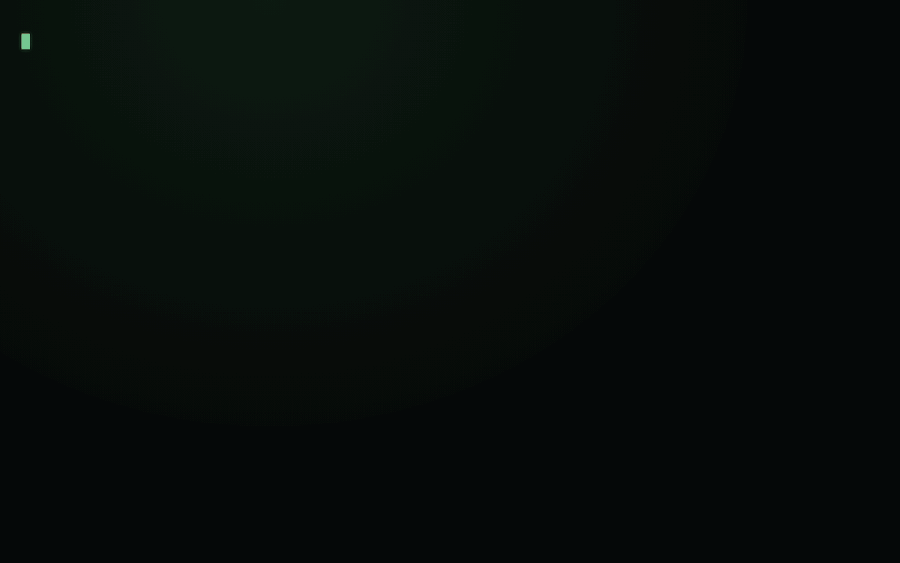
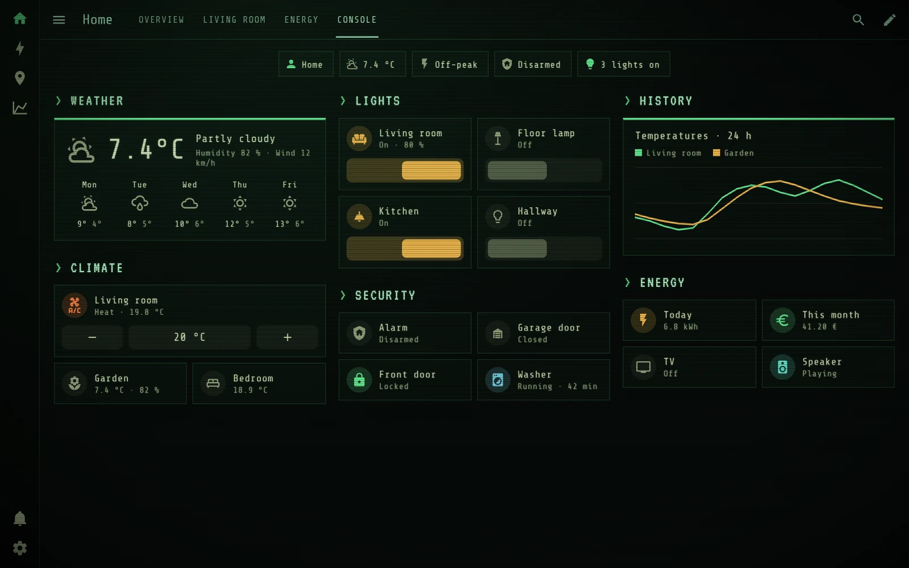
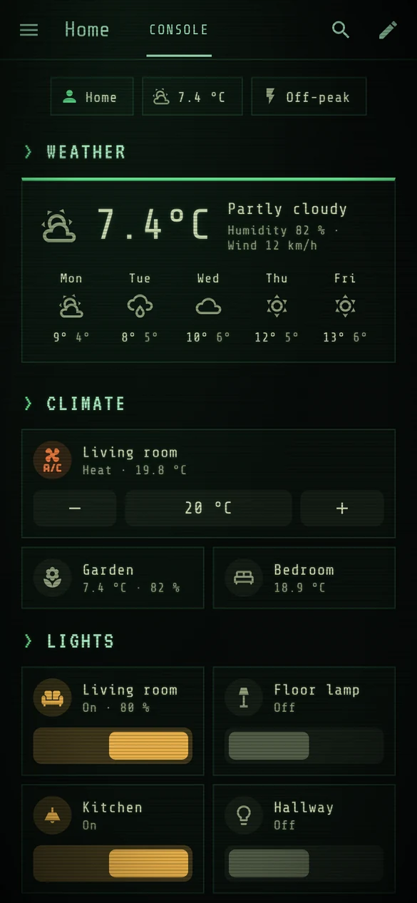
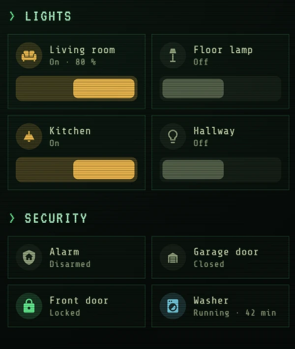

# Console CRT 📟

Thème Home Assistant façon **console de vaisseau des années 70-80** : fond quasi noir, texte kaki pâle, vert phosphore en accent, police de terminal et **filtre écran cathodique** (lignes de balayage, halo, scintillement) et séquence d'initialisation en ligne de commande à l'ouverture.



💬 Discussion et retours sur le [forum HACF](https://forum.hacf.fr/t/theme-console-crt-console-de-vaisseau-retro-avec-filtre-crt-hacs/85669).

> 🇬🇧 [English version below](#-english)

---

## 🖼️ Captures

| Ordinateur | Téléphone |
|---|---|
|  |  |

<p align="center"></p>

<sub>Rendus d'un tableau de bord de démonstration avec les styles réels du thème (données fictives).</sub>

## ✨ Ce que fait le thème

- **Couleurs** : fond `#070b09`, texte kaki pâle, textes secondaires olive, vert phosphore pour l'actif et les accents, ambre et rouge pour les alertes. Les couleurs nommées des tuiles (bleu, orange, violet…) sont adoucies façon terminal.
- **Cartes** à angles droits avec un liseré fin. Les grandes cartes (météo, graphiques, markdown, listes d'entités, lecteur média, thermostat) ont une barre verte en haut, comme les panneaux d'une console.
- **Titres de section** en majuscules espacées, en vert, précédés d'un chevron `>`.
- **Filtre CRT** : lignes de balayage, halo vert, bords assombris, texte légèrement lumineux et léger scintillement.
- **Initialisation** : à l'ouverture d'un onglet, quelques lignes de commande s'écrivent (« > INITIALIZING CONSOLE… », « > INTERFACE READY ») puis l'écran apparaît. Elle est **optionnelle** : choisis le thème `Console CRT (no intro)` pour t'en passer.
- Respecte le réglage « réduire les animations » du système.

## ✅ Ce qu'il faut avant

- **[card-mod](https://github.com/thomasloven/lovelace-card-mod)** (via HACS) pour les effets : filtre CRT, titres, barres des cartes. Sans card-mod, seules les couleurs s'appliquent.
- Le dossier de thèmes activé dans `configuration.yaml` (c'est déjà le cas si tu as installé un thème via HACS) :

```yaml
frontend:
  themes: !include_dir_merge_named themes
```

## 📦 Installation

[](https://my.home-assistant.io/redirect/hacs_repository/?owner=Robote7701&repository=console-crt-theme&category=theme)

1. HACS → **⋮** → Dépôts personnalisés → `https://github.com/Robote7701/console-crt-theme`, catégorie **Thème**, puis **Télécharger**.
2. Recharge les thèmes : Outils de développement → Actions → `frontend.reload_themes`.
3. **Polices** (recommandé) : Paramètres → Tableaux de bord → **⋮** → Ressources → **Ajouter**, URL `https://fonts.googleapis.com/css2?family=Share+Tech+Mono&family=VT323&display=swap`, type **Feuille de style**. Sans elles, le thème utilise une police monospace du système.
4. Choisis le thème, `Console CRT` (avec la séquence d'initialisation) ou `Console CRT (no intro)` (sans) :
   - pour toute l'interface : ton profil → **Thème** ;
   - ou pour un seul onglet : modifie l'onglet → **Thème**.

ℹ️ Pour que card-mod applique le thème plus vite au chargement, tu peux aussi le déclarer en `extra_module_url` (voir la doc de card-mod).

## ⚙️ Personnaliser

Tout est dans `themes/console-crt.yaml` :

- les couleurs en haut du fichier (`primary-color`, `primary-text-color`…) ;
- l'intensité des lignes de balayage : `rgba(0, 0, 0, 0.20)` dans `card-mod-view` ;
- la séquence d'initialisation : `crt-boot-display: block` pour l'activer, `none` pour la désactiver ; les textes sont dans `@keyframes crt-boot-text`.

## ⚠️ Limites

- Les cartes qui imposent leurs propres couleurs (graphiques avec couleurs fixées, cartes personnalisées) les gardent.
- Le filtre CRT couvre la zone des tableaux de bord, pas la barre latérale.
- Le chevron `>` des titres dépend de la structure interne de la carte « Titre » de Home Assistant : il peut disparaître après une mise à jour de HA (le reste du thème continue de fonctionner).

## 🙏 Crédits

- Polices [Share Tech Mono](https://fonts.google.com/specimen/Share+Tech+Mono) et [VT323](https://fonts.google.com/specimen/VT323) (SIL Open Font License).
- [card-mod](https://github.com/thomasloven/lovelace-card-mod) de Thomas Lovén.
- Licence [MIT](LICENSE).

---

## 🇬🇧 English

A Home Assistant theme styled like a **1970s–80s starship console**: near-black background, pale khaki text, phosphor green accents, terminal fonts and a **CRT filter** (scanlines, glow, flicker) and a command-line boot sequence when a view opens.

**Requirements:** [card-mod](https://github.com/thomasloven/lovelace-card-mod) for the effects (without it, only the colours apply), and `frontend: themes: !include_dir_merge_named themes` in `configuration.yaml`.

**Install:** HACS → Custom repositories → `https://github.com/Robote7701/console-crt-theme`, category **Theme** → Download → run `frontend.reload_themes`. For the fonts, add `https://fonts.googleapis.com/css2?family=Share+Tech+Mono&family=VT323&display=swap` as a **Stylesheet** dashboard resource. Then pick `Console CRT` or `Console CRT (no intro)` in your profile, or set it on a single view.

**What it does:** square cards with thin borders, a green top bar on large cards, uppercase green section headings with a `>` prefix, softened named colours, scanlines, green glow, dark edges, subtle flicker and a short command-line boot sequence (optional: pick `Console CRT (no intro)` to skip it, or set `crt-boot-display: none`). Respects the system "reduce motion" setting. Customise colours and effects in `themes/console-crt.yaml`.

**Limits:** cards with hard-coded colours keep them; the CRT filter covers dashboards, not the sidebar; the `>` heading prefix relies on the internal structure of Home Assistant's heading card and may disappear after an update.

Licence [MIT](LICENSE).
